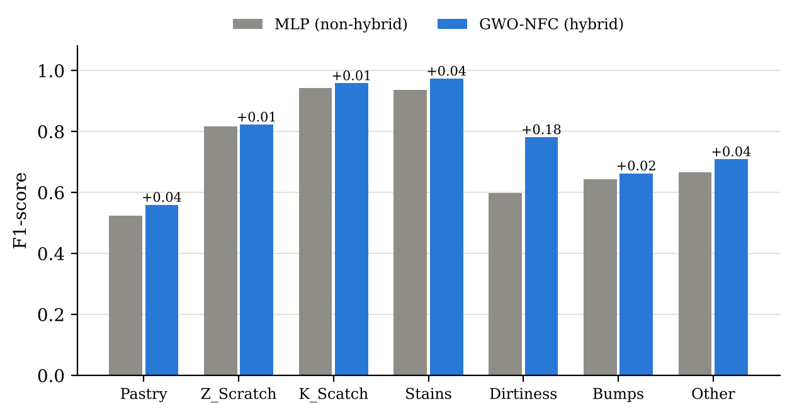
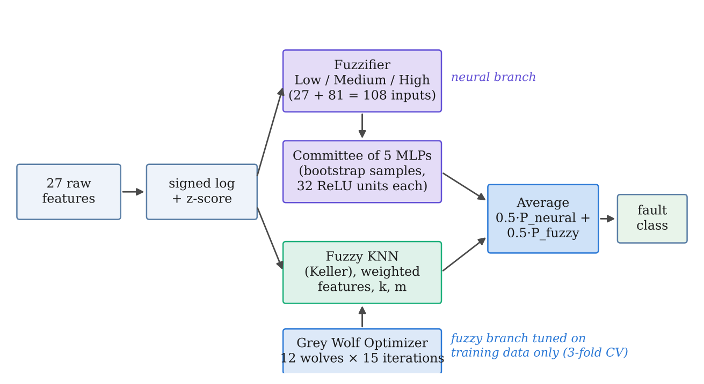

# Steel Plate Fault Classification: Non-Hybrid vs Hybrid Soft Computing

Soft Computing (23CS7PESCN) AAT project, B.M.S. College of Engineering.

This project compares a **non-hybrid** neural classifier with an original **hybrid soft-computing** classifier on the Steel Plates Faults dataset. That dataset is the real-world dataset used in the base paper:

> J. Gao, J. Li and W. Zang, "A hybrid high-dimensional feature selection method integrating an improved genetic algorithm and fuzzy neural network," *AIP Advances* 15, 115023 (2025). doi:10.1063/5.0301243

## Results

| Model | Accuracy (mean ± std) | Macro F1 (mean ± std) |
|---|---|---|
| MLP (non-hybrid) | 0.7287 ± 0.0347 | 0.7290 ± 0.0510 |
| **GWO-NFC (hybrid)** | **0.7620 ± 0.0212** | **0.7803 ± 0.0260** |

The hybrid wins all 5 test splits. The one-sided Wilcoxon signed-rank test gives p = 0.031, the smallest value possible with 5 splits.



## Dataset

- **Steel Plates Faults**, UCI Machine Learning Repository #198 (Buscema, Terzi & Tastle, 2010): https://archive.ics.uci.edu/dataset/198 (doi:10.24432/C5J88N)
- The full data has 1941 plates, 27 numeric features and 7 fault classes (Pastry, Z_Scratch, K_Scatch, Stains, Dirtiness, Bumps, Other_Faults).
- The project uses a **stratified subset of 1000 plates**, drawn with seed 42 so that every run uses the same plates.

| File | What it is |
|---|---|
| `data/Faults_full_UCI.NNA` | Original UCI data file (all 1941 rows) |
| `data/steel_faults_subset.csv` | The 1000-plate subset used in all experiments |
| `DATASET_LINK.docx` | Dataset link and citation |

The dataset is licensed by UCI under CC BY 4.0.

## Models

**Non-hybrid: MLP.** One multilayer perceptron with 32 ReLU hidden units, trained by back-propagation (Adam, 300 iterations) on z-scored features.

**Hybrid: GWO-NFC (Grey-Wolf-Optimised Neuro-Fuzzy Committee).** It combines three soft-computing families:

1. **Fuzzy logic.** Each feature is fuzzified into Low / Medium / High Gaussian memberships (27 crisp + 81 fuzzy = 108 inputs).
2. **Neural networks.** A bagged committee of 5 MLPs is trained on the fuzzified inputs.
3. **Fuzzy KNN** (Keller, 1985). It gives graded class memberships.
4. **Swarm intelligence.** A Grey Wolf Optimizer (12 wolves × 15 iterations) evolves 27 feature weights plus *k* and *m* of the Fuzzy KNN. Its fitness is 3-fold CV on training data only.

Final prediction: `0.5 × P_neural + 0.5 × P_fuzzy`.

None of these components appears in the base paper. The paper uses a genetic algorithm with a TSK fuzzy neural network, and compares against GA-SVM, PSO-NN, DE-SCA, Relief-F, mRMR and CAE.



## Evaluation protocol

- 5 stratified 70/30 train/test splits of the subset (`random_state` 0–4). Both models see exactly the same splits.
- Every scaler, fuzzy membership function and GWO fitness evaluation is fit on the training part of the split only.
- Paired one-sided Wilcoxon signed-rank test.

## Repository structure

```
├── data/
│   ├── Faults_full_UCI.NNA         original UCI dataset
│   └── steel_faults_subset.csv     1000-plate stratified subset
├── src/
│   ├── make_subset.py              rebuilds the subset from the UCI file
│   ├── hybrid_vs_nonhybrid.py      main experiment: MLP vs GWO-NFC
│   ├── detailed_analysis.py        per-class reports, ablation, timings
│   └── make_figures.py             builds all figures in figures/
├── results/                        CSV / JSON outputs
├── figures/                        all result figures used in the report
├── DATASET_LINK.docx               dataset link and citation
└── requirements.txt
```

## How to run

```bash
pip install -r requirements.txt

python src/hybrid_vs_nonhybrid.py   # main comparison (~20 s)
python src/detailed_analysis.py     # per-class tables, ablation, timings (~20 s)
python src/make_figures.py          # regenerates figures/

python src/make_subset.py           # optional: rebuilds data/steel_faults_subset.csv
```

Run all commands from the repository root. Results are deterministic: rerunning reproduces the numbers above exactly.

## Ablation (from `detailed_analysis.py`)

| Model | Accuracy | Macro F1 |
|---|---|---|
| MLP (non-hybrid) | 0.7287 | 0.7290 |
| Fuzzy KNN (k = 10, m = 2, no GWO) | 0.7293 | 0.7324 |
| Fuzzified MLP committee | 0.7427 | 0.7519 |
| GWO-weighted Fuzzy KNN | 0.7633 | 0.7762 |
| **GWO-NFC (full hybrid)** | **0.7620** | **0.7803** |

## Note on the paper's numbers

The paper reports 95.21% for FNN-GA on the full dataset, using a tuned classifier ensemble and repeated 5-fold cross-validation. This project uses a 1000-plate subset, five 70/30 splits and untuned networks, so the scores are not comparable to the paper's. What the project measures is the gain of the hybrid over a plain neural network under identical conditions.

## References

1. J. Gao, J. Li, W. Zang, *AIP Advances* 15, 115023 (2025).
2. M. Buscema, S. Terzi, W. Tastle, "Steel Plates Faults," UCI ML Repository (2010).
3. S. Mirjalili, S. M. Mirjalili, A. Lewis, "Grey Wolf Optimizer," *Advances in Engineering Software* 69, 46–61 (2014).
4. J. M. Keller, M. R. Gray, J. A. Givens, "A fuzzy K-nearest neighbor algorithm," *IEEE Trans. SMC* 15(4), 580–585 (1985).
5. L. Breiman, "Bagging predictors," *Machine Learning* 24(2), 123–140 (1996).
